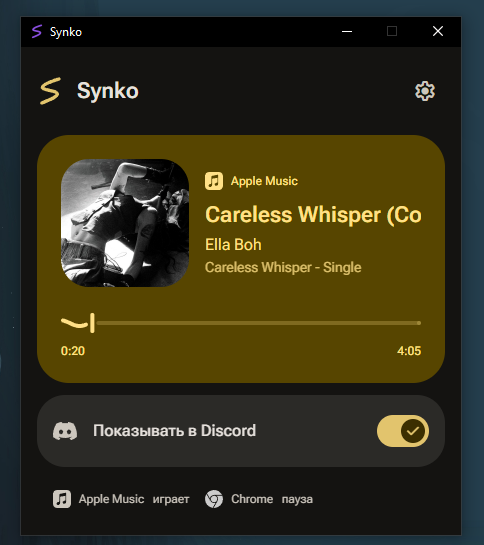

# Synko

[Русский](#русский) / [English](#english) / [Releases](https://github.com/zephrx0/Synko/releases)

Музыка Apple Music и видео из браузера в профиле Discord. Нативная фоновая служба Windows, локальный интерфейс, светлая и тёмная темы.



## Русский

### Возможности

- Apple Music и браузеры через медиасессии Windows, без токена Discord
- Режим «Авто», отдельный выбор Apple Music или браузера, поддержка всех медиаплееров Windows
- Распознавание YouTube, превью текущего видео, кнопка перехода к ролику в Discord
- Обложки Apple Music из каталога Apple и картинки из системной медиапанели
- Снятие активности на паузе, при остановке и выключении публикации
- Иконки Chrome, Edge, Firefox, Brave, Opera / GX, Vivaldi, Arc, Яндекс, Chromium, Thorium, LibreWolf, Waterfox, Floorp и Zen
- Тема Windows или ручной выбор, цвет из обложки, системного акцента или образца
- Волнистый прогресс, плавные переходы, учёт уменьшенной анимации Windows
- Работа в трее, автозапуск и встроенное обновление из GitHub Releases

### Установка

Windows 10/11 x64. Нужен Microsoft Edge WebView2 Runtime. Отдельно устанавливать .NET для автономной сборки не требуется.

Скачайте [Synko-win-x64.zip](https://github.com/zephrx0/Synko/releases/latest/download/Synko-win-x64.zip), распакуйте в постоянную папку и запустите `Synko.exe`.

Для собственной сборки: `artifacts\Synko-win-x64\Synko.exe`. Размер автономного exe составляет около 55 МиБ; точный размер зависит от версии.

### Подключение Discord

1. Откройте настольный клиент Discord.
2. Создайте приложение в [Developer Portal](https://discord.com/developers/applications).
3. Скопируйте Application ID в Synko. Приложение проверит его через локальный Discord RPC. Токен бота и Client Secret не нужны.
4. Выберите «Авто» и включите «Показывать в Discord».

Если выбран только Apple Music, браузер исключается из публикации. В режиме «Авто» играющий браузер выбирается и тогда, когда Apple Music остаётся на паузе. Браузер должен передавать сведения в медиапанель Windows.

Превью внутри Synko доступно и для фоновой вкладки через Windows Media. Для ссылки и публичной обложки YouTube в Discord нужен адрес ролика. Он читается из адресной строки видимой вкладки и запоминается для текущего трека; если приложение запущено при уже фоновой вкладке, откройте её один раз. В обычном режиме Synko не переключает вкладки, не управляет плеером и не читает историю браузера.

### Настройки и трей

Настройки открываются в том же окне и применяются сразу. Доступны источник, публикация, обложки Apple Music, превью YouTube, тема, цвет, автозапуск и запасная иконка Discord.

Закрытие окна сворачивает Synko в трей. Двойной щелчок возвращает окно; «Выход» в меню трея завершает приложение. Настройки сохраняются в `%LOCALAPPDATA%\NowPlaying\settings.json`. Обновление сохраняет существующий Application ID и ключ картинки.

### Обновления

В настройках доступны «Проверять при запуске», «Проверить обновления» и «Обновить и перезапустить». Synko принимает стабильные релизы `zephrx0/Synko`, проверяет размер, SHA-256 из GitHub API и версию exe, затем завершает RPC, заменяет файл и запускается снова. Предыдущий exe сохраняется на случай ошибки.

Автоматическая проверка не устанавливает обновления без нажатия кнопки.

### Сборка и проверки

Нужен .NET 10 SDK:

```powershell
powershell -NoProfile -ExecutionPolicy Bypass -File .\build.ps1 -Test
```

Результат: `artifacts\Synko-win-x64\Synko.exe`, ZIP, отдельный exe с версией и SHA-256. Для проверки готового приложения:

```powershell
Start-Process .\artifacts\Synko-win-x64\Synko.exe -ArgumentList '--smoke-ui', "$PWD\artifacts\production-check" -Wait
Start-Process .\artifacts\Synko-win-x64\Synko.exe -ArgumentList '--preview-ui', "$PWD\artifacts\screenshots" -Wait
```

Проверка интерфейса использует отдельные настройки и тестовую ветку реестра, не публикует активность и не меняет пользовательский автозапуск. Подробности: [матрица проверок](docs/TESTING.md), [публикация и обновление](docs/PUBLISHING.md).

## English

Synko shows Apple Music and browser playback in your Discord profile using Windows media sessions and local Discord RPC.

### Features

- Automatic source selection, Apple Music, browser-only and all-player modes
- YouTube detection, video thumbnails and a link to the current video
- Apple Music artwork and native Windows media thumbnails
- Activity cleared on pause or when sharing is disabled
- Icons for 15 recognised browser identities
- System, light and dark themes, artwork colours and custom accents
- Wavy playback progress, reduced-motion support and a background tray app
- Startup registration and verified updates from GitHub Releases

### Setup

Windows 10/11 x64 and Microsoft Edge WebView2 Runtime are required. The portable build includes .NET.

Download [Synko-win-x64.zip](https://github.com/zephrx0/Synko/releases/latest/download/Synko-win-x64.zip), extract it to a permanent folder and run `Synko.exe`. Locally built files are available in `artifacts\Synko-win-x64`.

Create an application in the [Discord Developer Portal](https://discord.com/developers/applications), paste its Application ID into Synko, select Auto and enable sharing. A bot token and Client Secret are not required.

Background tabs can provide in-app artwork through Windows Media. To publish a YouTube thumbnail and video link to Discord, Synko needs the video URL from the active address bar. If Synko starts while the video is already in a background tab, open that tab once. The normal app does not switch tabs, control playback or read browser history.

Closing the window hides it to the tray. Double-click the tray icon to reopen it; use Exit to quit. Existing settings remain in `%LOCALAPPDATA%\NowPlaying`.

### Updates

The updater checks stable GitHub Releases, verifies the asset size, GitHub SHA-256 digest and executable version, saves the previous executable and restarts the app. Checking does not install an update automatically.

### Build

Install .NET 10 SDK and run `build.ps1 -Test`. The GitHub workflow builds and uploads artifacts; it does not publish releases automatically.

### Credits

.NET / WinForms, WebView2, Material Color Utilities, Roboto Flex, Material Symbols Rounded, Simple Icons and Browser Logos. [Dependency notes and licences](docs/third-party/synko-ui.md).
